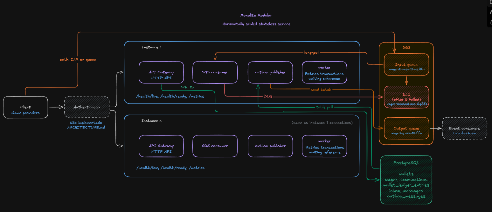

# Arquitetura

Este documento registra as decisões de arquitetura do Distributed Wagering Processor, os trade-offs de cada uma e as limitações conhecidas. Identificadores de código (classes, tabelas, constraints, métricas, códigos de falha) ficam em inglês, como no código.

O detalhe completo (requisitos `R-xx`, testes `T-xx`, perguntas `OQ-xx` decididas, SQL do schema) está em [`docs/spec.md`](docs/spec.md); aqui ficam a decisão, o motivo e o custo, com links para a seção exata. O enunciado em [`docs/challenge.md`](docs/challenge.md) é a fonte da verdade: se este documento e o enunciado divergirem, vale o enunciado.

## Sumário

1. [Diagrama do sistema](#1-diagrama-do-sistema)
2. [Decisões em 1 minuto](#2-decisões-em-1-minuto)
3. [Estado da implementação](#3-estado-da-implementação)
4. [Visão geral, camadas e papéis](#4-visão-geral-camadas-e-papéis)
5. [Stack e ORM](#5-stack-e-orm)
6. [Money](#6-money)
7. [Modelo de domínio e máquina de estados](#7-modelo-de-domínio-e-máquina-de-estados)
8. [Estratégia transacional](#8-estratégia-transacional)
9. [Estratégia de concorrência](#9-estratégia-de-concorrência)
10. [Garantias no schema do banco](#10-garantias-no-schema-do-banco)
11. [Idempotência e hash do payload](#11-idempotência-e-hash-do-payload)
12. [API HTTP e códigos de falha](#12-api-http-e-códigos-de-falha)
13. [Mensageria: inbox, consumidor SQS, DLQ e desligamento](#13-mensageria-inbox-consumidor-sqs-dlq-e-desligamento)
14. [Transactional Outbox](#14-transactional-outbox)
15. [Referências fora de ordem](#15-referências-fora-de-ordem)
16. [Observabilidade e autenticação](#16-observabilidade-e-autenticação)
17. [Estratégia de testes](#17-estratégia-de-testes)
18. [Limitações conhecidas](#18-limitações-conhecidas)

## 1. Diagrama do sistema

## 2. Decisões em 1 minuto

Todas as `OQ-xx` foram decididas em 2026-11-06; alternativas na [seção 4 de `docs/spec.md`](docs/spec.md#4-open-questions).

| Decisão | Escolha | Por quê | Trade-off |
|---|---|---|---|
| Stack e ORM (OQ-03) | Bun, NestJS 12, PostgreSQL 18, MikroORM 7, Zod (OQ-18), Biome (OQ-19) | MikroORM é o preferido do enunciado e traz Unit of Work, `transactional()` com propagação e `LockMode` com `SKIP LOCKED` | Armadilha do fork capturado abrindo outra transação, mitigada por regra e teste (seção 5) |
| Money (OQ-17, OQ-08) | `bigint` de centavos + ISO-4217; entrada string estrita com exatamente 2 casas | Aritmética exata sem biblioteca; hash sem ambiguidade | `"25"` e `"1.005"` recebem 400, sem arredondamento |
| Estratégia transacional | Uma transação SQL por operação: transação, ledger, carteira, outbox e (no SQS) inbox | Nada fica meio aplicado; nenhum evento sai antes do commit | Um processo precisa enxergar tudo no mesmo banco |
| Concorrência (OQ-04) | Lock pessimista `FOR UPDATE` na linha da carteira, `READ COMMITTED` | Fila no banco, sem tempestade de retries, sem deadlock, regras no domínio | Vazão de uma carteira limitada pela seção crítica |
| Garantias no banco (OQ-20) | Constraints, triggers e checagens diferidas além do mínimo | Unicidade, imutabilidade e não negatividade valem mesmo com bug no código | Cerca de 60 linhas de SQL a mais |
| Idempotência (OQ-13) | Chave por provedor; SHA-256 do JSON canônico de um subconjunto fixo | Replay idêntico entre HTTP, SQS, reinícios e instâncias | Estado só no PostgreSQL, sem cache |
| Unicidade de reversão (OQ-07) | No máximo uma reversão processada, de qualquer tipo, por referência | A leitura literal permitiria `REFUND` e `ROLLBACK` do mesmo `BET` | Mais estrito que o texto do enunciado |
| `WIN`/`LOSS` (OQ-14) | Referência opcional a um `BET` processado; só `LOSS` aceita `0.00` | Um `WIN` zero não faz sentido; o provedor envia `LOSS` | - |
| Mapeamento HTTP (OQ-10, OQ-11) | Status como função do status da transação: 201, 202, 422; conflitos 409; transitório 503 | Primeira resposta e replays são iguais, como exige o enunciado | Carteira inexistente no corpo é 422, não 404 |
| Inbox e consumidor (OQ-22, OQ-23) | Inbox na mesma transação; transitório faz backoff por visibility timeout; permanente vai para a DLQ | Efeito exatamente uma vez sobre entrega pelo menos uma vez | Mensagem em backoff bloqueia seu grupo FIFO |
| Outbox (OQ-16) | `FOR UPDATE SKIP LOCKED` com lock preso durante o envio para `wagering-events.fifo` | Publicadores concorrentes sem coluna de lease; nunca desiste | Transação aberta por até 5 s; duplicatas limitadas |
| Janela de referência pendente (OQ-09) | 20 tentativas, 1 s a 300 s, cerca de 63,5 min | Cobre incidentes reais do provedor sem deixá-lo sem resposta por um dia | Reversão antecipada espera o próximo degrau do backoff |
| `FAILED` (OQ-15) | Só na retentativa de `PENDING_REFERENCE` com erro permanente; sem evento | No caminho síncrono o erro aborta tudo e o chamador reenvia | Visível só por log, métrica e consulta |
| Implantação (OQ-05) | Uma imagem, papéis por `APP_ROLES`, 3 instâncias no Compose | Mantém a fronteira transacional única; separar é só configuração | Um único deployable |
| Autenticação (OQ-01) | Guard no-op + `ProviderIdentityPort`; desenho OIDC documentado | Vale 0 pontos e o enunciado aceita; tempo vai para áreas pontuadas | Nenhum provedor é autenticado |
| Emulador SQS (OQ-02) | MiniStack | O enunciado aceita LocalStack ou MiniStack; o LocalStack exige token desde 2026.03 e o MiniStack (MIT) passou nas checagens FIFO | - |
| Escopo (OQ-06, OQ-12, OQ-21) | Sem diferenciais; este documento em pt-BR; ledger do mais novo para o mais antigo | Foco nos 100 pontos avaliados; público é a banca | - |

## 3. Estado da implementação

A entrega seguiu PRs por slice ([seção 5 de `docs/spec.md`](docs/spec.md#5-task-breakdown)); a situação de cada slice está no [`README.md`](README.md#estado-da-implementação). Os slices S-01 a S-07 (domínio, persistência, API HTTP, consumidor SQS, publicador do outbox e retentador) estão na branch principal. De S-08 (observabilidade) falta só a lista de `redact` do pino; de S-09 (suíte de concorrência e recuperação) estão T-C1, T-C2, T-C3, T-C5 e T-C8. O que ficou de fora está na [seção 18](#18-limitações-conhecidas).

## 4. Visão geral, camadas e papéis

Arquitetura hexagonal em um único código e uma única imagem ([spec 3.1](docs/spec.md#31-architecture-and-boundaries)):

| Camada | Pasta | Responsabilidade |
|---|---|---|
| Domínio | `src/domain` | Entidades, value objects, serviços de domínio e eventos. TypeScript puro; importa só o domínio. |
| Aplicação | `src/application` | Casos de uso (`CreateWallet`, `SubmitWagerTransaction`, `ReconcileWallet`, consultas) e suas portas (`WalletRepository`, `UnitOfWork`, `Clock`, `IdGenerator`, `ProviderIdentityPort` etc.). Sem decorators do NestJS. |
| Entrada | `src/interfaces` | Controllers HTTP, schemas Zod, filtro de erros, consumidor SQS e workers agendados. |
| Saída | `src/infrastructure` | Persistência MikroORM, cliente SQS, pino, prom-client, configuração. |
| Composição | `src/main.ts`, `src/*.module.ts`, `src/roles.ts` | Monta a aplicação para os papéis habilitados. |

`test/unit/architecture.test.ts` verifica a regra de dependência pelos imports e barra `parseFloat`, `parseInt`, `Number(` e `: number` em `src/domain/money`.

**Papéis (OQ-05).** `APP_ROLES` (padrão `api,consumer,outbox,pending-reference`) escolhe o que cada processo roda; todos são seguros com qualquer número de instâncias, e `/health/*` e `/metrics` existem em toda instância. O enunciado exige que inbox, mudança financeira, ledger e outbox sejam confirmados na mesma transação SQL: separar API, consumidor e publicador em serviços dividiria essa fronteira entre serviços que compartilhariam o banco (anti-padrão) ou exigiria transação distribuída. Com papéis configuráveis, as 3 instâncias do Compose exercitam todos os caminhos concorrentes, e em produção a mesma imagem pode ser implantada por papel.

**Fluxos:** HTTP valida com Zod e chama `SubmitWagerTransaction`; SQS abre a transação, grava o inbox e chama o mesmo caso de uso; o publicador reivindica linhas do outbox com `SKIP LOCKED` e envia; o retentador trava a carteira e reexecuta a mesma regra de domínio para transações `PENDING_REFERENCE`.

## 5. Stack e ORM

Bun 1.4.4 (runtime, pacotes e testes), TypeScript strict, NestJS 12 com Express, PostgreSQL 18 (`transaction_timeout` exige 17+), MikroORM 7, MiniStack 1.5.37, Zod 4, pino, prom-client, Biome 2, UUIDv7 pela porta `IdGenerator`. Tabela completa em [spec 3.3](docs/spec.md#33-technology-choices).

**Por que MikroORM (OQ-03).** Unit of Work e Identity Map explícitos, `em.transactional()` com propagação e `LockMode` que gera exatamente as cláusulas usadas (`PESSIMISTIC_WRITE` vira `FOR UPDATE`; `PESSIMISTIC_PARTIAL_WRITE` vira `FOR UPDATE SKIP LOCKED`), tudo verificado sob Bun antes da implementação ([apêndice A](docs/spec.md#appendix-a-toolchain-facts-verified-for-this-spec)). O TypeORM funcionaria, mas não acrescenta nada.

**Como é usado** ([spec 3.4](docs/spec.md#34-orm-mikroorm-7)):

- Records de persistência com `EntitySchema` (sem decorators) separados do domínio; mappers convertem sempre pelas fábricas `rehydrate`. O domínio não conhece tipos do ORM.
- Migrations escritas à mão com `up()`/`down()` e SQL explícito para constraints, índices parciais e triggers; o gerador de schema não é usado para DDL.
- Repositórios e unit of work usam o `EntityManager` do contexto, nunca um fork capturado em closure: esse é o risco principal (outra transação quebraria a atomicidade), mitigado por esta regra e pelo teste de atomicidade T-I2. Trabalho fora de HTTP roda em `RequestContext.create` com `allowGlobalContext: false`. As FKs compostas do ledger são diferidas, então a correção não depende da ordem de flush.

## 6. Money

**Representação (OQ-17):** `bigint` de unidades menores (centavos) mais o código ISO-4217, escala fixa 2 para toda moeda, como exige o enunciado. Com escala fixa, somar, subtrair e comparar inteiros é exato, sem biblioteca decimal. `decimal.js` foi descartada: sua precisão é em dígitos significativos e o padrão (20) já é ocupado por um `numeric(20,2)` grande.

**Entrada (OQ-08):** `Money.from({ amount, currency })` exige `amount` string em `^(0|[1-9][0-9]{0,17})\.[0-9]{2}$` (não negativo, exatamente duas casas, até 18 dígitos inteiros, sem sinal, expoente, espaços ou zeros à esquerda) e `currency` em `^[A-Z]{3}$`. `NaN`, `Infinity`, notação científica, vazio, mais de 2 casas, negativos e números JSON recebem `InvalidMoneyError` (400). `"1.005"` é recusado, não arredondado: nenhuma operação precisa de arredondamento. O formato estrito também deixa o hash sem ambiguidade (`"25"` e `"25.00"` nunca coexistem).

**Reidratação e aritmética:** `Money.rehydrate` aceita um `-` opcional, porque uma soma sobre um ledger inconsistente pode ser negativa e a reconciliação precisa reportá-la; `add`, `subtract` e `negate` podem gerar negativos; `toJSON()`/`toString()` sempre renderizam duas casas. Operação entre moedas diferentes lança `CurrencyMismatchError`; o modelo é multimoeda (testes cobrem `USD` contra carteira `BRL`).

**Banco e fronteiras:** colunas `numeric(20,2)` com `char(3)` de moeda ao lado; o MikroORM mapeia `decimal` como string e o mapper monta `Money`. Nenhum valor monetário vira `number` do JavaScript em nenhum ponto (domínio, DTOs, mensagens, colunas, eventos, logs), e o SQL nunca faz cast para `float`. Eventos carregam `MoneyProps` (`{ amount, currency }` em strings).

## 7. Modelo de domínio e máquina de estados

Classes de domínio têm construtores privados e fábricas estáticas; não há setters públicos, o estado muda só por transições nomeadas, e `rehydrate` reconstrói sem revalidar ([spec 3.6](docs/spec.md#36-domain-model-decisions)).

- **`Wallet`** (aggregate root): `debit` e `credit` checam moeda, lançam `InsufficientFundsError` se o saldo ficaria negativo, incrementam `version` em exatamente 1 e **retornam** o `WalletLedgerEntry`. Como o lançamento é o valor de retorno dos únicos métodos que mudam saldo, saldo e ledger não divergem no domínio.
- **`WalletLedgerEntry`**: só campos `readonly`; `create` valida `balanceBefore +/- money == balanceAfter`, valor positivo, mesma moeda e saldos não negativos.
- **`WagerTransaction`**: guarda `observedBalance` e `observedWalletVersion` (o que um replay devolve) e o `correlationId` para o retentador.
- **`WagerTransactionProcessor`** (serviço puro, com `ReferencePolicy`): devolve `Applied`, `Rejected` ou `AwaitingReference`. Submissão e retentador usam o mesmo processador, então as regras existem em um só lugar.
- **`OPENING`**: tipo interno criado por `CreateWallet` já `PROCESSED`, com provedor `_system` (inválido na API) e chave `wallet-opening:{walletId}`; não pode ser submetido por HTTP nem SQS.

| Tipo | Efeito | Referência |
|---|---|---|
| `BET` | Débito; `INSUFFICIENT_FUNDS` se faltar saldo. | Proibida. |
| `WIN` | Crédito. | Opcional; `BET` `PROCESSED` do mesmo escopo (OQ-14). |
| `LOSS` | Nenhum movimento nem lançamento; `PROCESSED`; pode ser `0.00`. | Opcional, como `WIN`. |
| `REFUND` | Crédito do valor do `BET`. | Obrigatória; só `BET`. |
| `ROLLBACK` | Inverso da referência (`BET` vira crédito; `WIN`/`REFUND` vira débito, com `REVERSAL_INSUFFICIENT_FUNDS`). | Obrigatória; `BET`, `WIN` ou `REFUND`. |

Toda referência é resolvida por `(providerId, referenceExternalTransactionId)` e precisa ser do mesmo provedor, jogador, carteira, moeda e rodada. Reversões não são parciais. `REJECTED` não muda saldo nem gera lançamento.

**Estados:** uma transação nasce `PENDING` e nunca é confirmada assim; a mesma transação SQL a leva a `PROCESSED`, `REJECTED` ou `PENDING_REFERENCE`. Do `PENDING_REFERENCE`, o retentador leva a `PROCESSED`/`REJECTED` (inclusive por tentativas esgotadas) ou `FAILED`. `PROCESSED`, `REJECTED` e `FAILED` são terminais: o domínio lança `InvalidTransactionStateError` e o trigger do banco lança `restrict_violation`. Tabela completa em [spec 3.7](docs/spec.md#37-transaction-status-state-machine).

**`FAILED` (OQ-15)** só aparece quando a retentativa encontra um erro permanente que não é de negócio (por exemplo, violação de integridade que indica bug). No caminho síncrono, um erro de infraestrutura aborta a transação, nada é persistido e o chamador reenvia. `FAILED` não gera evento.

## 8. Estratégia transacional

**Uma transação SQL por operação de negócio.** A porta `UnitOfWork.run(work)` chama `em.transactional(work)` com propagação `REQUIRED`, então um `run` interno se junta ao externo; é assim que o consumidor grava o inbox e chama o mesmo caso de uso numa só transação. `SubmitWagerTransaction` grava juntos a `WagerTransaction`, o lançamento (se houver), a carteira (se mudou), as linhas do outbox e, no SQS, o inbox. `CreateWallet` grava carteira, `OPENING`, lançamento e outbox. Nenhum evento sai antes do commit: só o publicador fala com a fila de eventos, e ele lê apenas linhas confirmadas.

**Algoritmo** ([spec 3.8](docs/spec.md#38-processing-algorithm-submitwagertransaction)): validação Zod no adaptador; cálculo do `payloadHash`; caminho rápido de idempotência sem lock; abre o unit of work; `SELECT ... FOR UPDATE` na carteira (`PESSIMISTIC_WRITE`, `refresh: true`); checagem autoritativa de idempotência e de `(providerId, externalTransactionId)` sob o lock; cria a transação, checa escopo, resolve a referência, aplica pelo processador, persiste e confirma.

**Isolamento `READ COMMITTED`, de propósito.** Depois de esperar um lock de linha, `FOR UPDATE` devolve a versão confirmada mais recente e os comandos seguintes enxergam os efeitos de quem segurava o lock. `REPEATABLE READ` geraria falhas de serialização em carteira disputada.

**Corridas em chaves únicas.** Um `23505` em `wager_tx_provider_idempotency_uq`, `wager_tx_provider_external_uq` ou `wager_tx_single_reversal` aborta a transação; o dono da transação mais externa (o caso de uso no HTTP, o handler por mensagem no SQS) repete a unidade inteira uma vez em um `RequestContext` novo. Na repetição, o caminho rápido ou a checagem de referência devolve replay, conflito ou `REFERENCE_ALREADY_REVERSED`. Uma segunda violação vira `TransientInfrastructureError`.

**Timeouts, para que banco indisponível termine em erro transitório rápido e nunca em requisição pendurada:** no servidor, `lock_timeout` 2 s, `statement_timeout` 5 s, `transaction_timeout` 8 s, `idle_in_transaction_session_timeout` 10 s; no pool `pg`, `connectionTimeoutMillis` 2 s, `query_timeout` 6 s e `keepAlive`. Os de cliente são necessários porque um servidor congelado (`docker compose pause`) não dispara os de servidor. `pg-error-classifier.ts` traduz erros de conexão e timeout e os SQLSTATEs `55P03`, `40P01`, `40001`, `08*`, `57P01`-`57P03`, `57014`, `25P03`, `25P04` e `53300` para `TransientInfrastructureError` (503, retry no SQS). Outras violações de integridade indicam bug ou overflow: 500, permanente no SQS, `FAILED` no retentador.

## 9. Estratégia de concorrência

**Decisão (OQ-04): lock pessimista de linha por carteira.** Toda transação que mexe em saldo executa `SELECT ... FOR UPDATE` em exatamente uma linha de `wallets`, na mesma transação que grava transação, lançamento, carteira e outbox. A unidade de concorrência é o `walletId`.

| Situação | Como é tratada |
|---|---|
| Duas apostas pelo mesmo saldo | A segunda espera o lock, lê o saldo já debitado e é rejeitada com `INSUFFICIENT_FUNDS` se não houver saldo. |
| Várias instâncias | O lock vive no PostgreSQL e serializa escritores entre processos e hosts; não há lock em memória nem global. |
| Carteira muito disputada | Fila no lock, sem retries desperdiçados. Seção crítica curta: sem I/O de rede (o evento é um insert no outbox), uma carteira, cerca de 5 comandos. `lock_timeout` (2 s) transforma filas patológicas em erro transitório. |
| Carteiras diferentes | Locks independentes, paralelismo total. |
| Deadlock | Impossível: cada transação trava no máximo uma carteira, e o retentador a trava primeiro, na mesma ordem de todos. |
| Ordem do broker | Só otimização. `MessageGroupId = walletId` reduz disputa, mas a correção não depende disso: as invariantes vivem no lock de linha e nas constraints. |

**Defesa em profundidade:** o trigger `guard_wallet_update` recusa mudança de saldo sem `version` + 1, `CHECK (balance >= 0)` recusa negativos e o constraint trigger diferido `wallets_balance_change_requires_ledger_entry` recusa no commit saldo alterado sem lançamento.

**Alternativas descartadas:** optimistic locking com retry (degrada sob disputa e transforma 50 apostas iguais em tempestade de conflitos; o `version` continua existindo, protegido pelo banco); `UPDATE ... WHERE balance >= $a` (move a regra para o SQL e ainda precisa do lock para idempotência e reversão); advisory lock (segundo mecanismo sem ganho).

**Custo:** a vazão de uma carteira é limitada pela seção crítica; aceitável, pois um jogador raramente gera centenas de operações por segundo, e carteiras diferentes escalam em paralelo.

**Evidência:** no laboratório da especificação, 3 processos Bun reproduziram o cenário obrigatório (um `PROCESSED`, um `REJECTED`, saldo `20.00`, 1 débito), a mesma chave 50 vezes (1 processada, 49 replays) e 60 apostas de `10.00` sobre `100.00` (10 processadas, 50 rejeitadas, saldo `0.00`). Na implementação, `test/integration/wagering/mandatory-scenario.test.ts` cobre em processo o cenário obrigatório, a mesma aposta 50 vezes e 20 apostas distintas; a prova com 3 processos reais via HTTP é T-C1 (a mesma aposta 50 vezes), T-C2 (o cenário obrigatório) e T-C3 (5 carteiras distintas recebendo apostas ao mesmo tempo, cada uma com saldo, versão e débitos esperados).

## 10. Garantias no schema do banco

Unicidade, imutabilidade e não negatividade são garantidas pelo schema, não só pelo código, em uma única migration inicial com `down()` reversível. As guardas além do mínimo (OQ-20: trigger de estados, guarda de versão, checagens diferidas entre saldo e ledger, FKs compostas) somam cerca de 60 linhas de SQL, todas verificadas. SQL completo em [spec 3.10](docs/spec.md#310-postgresql-schema).

| Garantia | Onde |
|---|---|
| Uma carteira por jogador e moeda | `wallets_player_currency_uq` |
| Saldos não negativos | `CHECK (balance >= 0)`, checagens de `balance_before`/`balance_after` e `observed_balance` |
| `version` muda só com o saldo, de 1 em 1 | trigger `guard_wallet_update` |
| Toda mudança de saldo tem seu lançamento exato, e vice-versa | constraint triggers diferidos `wallets_balance_change_requires_ledger_entry` e `ledger_entry_requires_wallet_change`, `ledger_wallet_version_uq` |
| Aritmética e vínculo do lançamento | `ledger_balanced`, `amount > 0`, FKs compostas diferidas `ledger_transaction_fk` e `ledger_wallet_currency_fk`, `ledger_one_entry_per_transaction_wallet` |
| Ledger append-only | triggers `ledger_forbid_update_delete`, `ledger_forbid_truncate` |
| Idempotência e id externo únicos | `wager_tx_provider_idempotency_uq`, `wager_tx_provider_external_uq` |
| No máximo uma reversão processada por referência | índice único parcial `wager_tx_single_reversal` |
| Abertura única e só interna | `wager_tx_one_opening_per_wallet`, `wager_tx_opening_is_internal` |
| Terminais e colunas da requisição imutáveis; só transições válidas | trigger `guard_wager_transaction_update`, triggers de delete e truncate, checagens `wager_tx_*_iff_*` e `*_when_*` |
| Deduplicação do inbox | chave primária `(consumer_name, message_id)` |

As checagens de ledger são `DEFERRABLE INITIALLY DEFERRED` (rodam no commit, independentes da ordem de flush) e as funções de trigger fixam `search_path`.

## 11. Idempotência e hash do payload

**Chave:** header `Idempotency-Key` (no SQS, `data.idempotencyKey`), obrigatório, 1 a 255 caracteres ASCII visíveis; recomendado `"{providerId}:{externalTransactionId}"`, não imposto. **Escopo por provedor (OQ-13):** unicidade em `(provider_id, idempotency_key)`.

**Hash:** SHA-256 em hexadecimal minúsculo dos bytes UTF-8 do JSON canônico (chaves ordenadas em todos os níveis, sem espaços, escape de `JSON.stringify`) de exatamente `providerId`, `externalTransactionId`, `playerId`, `walletId`, `roundId`, `gameId`, `kind`, `money.amount`, `money.currency` e `referenceExternalTransactionId` (só se presente). Ficam de fora a chave, `messageId`, `type`, `occurredAt`, headers, correlação e campos desconhecidos. UUIDs vão em minúsculas; demais strings como vieram. Implementado em `src/application/shared/canonical-json.ts` e `src/application/wagering/payload-hash.ts`; vetor de teste em [spec 3.11](docs/spec.md#311-idempotency-and-payload-hash).

**Resultado:**

- Mesma chave e mesmo hash: replay do resultado armazenado (status, código de falha e saldo observado), com `idempotentReplay: true` e o mesmo status HTTP.
- Mesma chave e hash diferente: `409 IDEMPOTENCY_KEY_CONFLICT`, nunca replay.
- Mesmo `(providerId, externalTransactionId)` com outra chave: `409 EXTERNAL_TRANSACTION_CONFLICT`.
- Replay de `PENDING_REFERENCE` devolve o estado atual (202); depois de resolvida, o final.
- HTTP e SQS montam o mesmo comando, então uma operação enviada por um e repetida pelo outro é replay.

**Onde vive o estado:** só em `wager_transactions`. Sem cache de respostas nem memória, a idempotência sobrevive a reinícios e vale entre instâncias. A checagem roda sem lock (caminho rápido), de novo sob o lock da carteira (autoritativa) e as constraints únicas são a última barreira.

## 12. API HTTP e códigos de falha

**Status (OQ-10):** o status de um resultado é função pura do status da transação: `PROCESSED` 201, `PENDING_REFERENCE` 202, `REJECTED` e `FAILED` 422. Uma requisição idêntica sempre recebe a mesma resposta; só `idempotentReplay` muda. O `422` de processamento é o próprio resultado da transação, com `code` igual ao `failureCode`, então o provedor recebe também `transactionId`, `status` e `balance`. Descartados: `200` para replays (o enunciado pede a mesma resposta), `500` para `FAILED` (convidaria a reenviar um terminal) e `200` para tudo (obrigaria a ler o corpo para decidir reenviar). Endpoints, paginação e corpos em [spec 3.13](docs/spec.md#313-http-api-and-status-mapping).

Códigos são estáveis, em inglês, nunca traduzidos ([spec 3.12](docs/spec.md#312-failure-code-taxonomy)). Toda rejeição é final para seu `(providerId, externalTransactionId)`; "corrigir e reenviar" é sempre uma nova operação com novo id externo e nova chave.

| HTTP | Códigos | O provedor deve |
|---|---|---|
| 201 / 202 | `PROCESSED` / `PENDING_REFERENCE` | Seguir / aguardar ou consultar |
| 422 (rejeição persistida) | `INSUFFICIENT_FUNDS`, `REVERSAL_INSUFFICIENT_FUNDS`, `CURRENCY_MISMATCH`, `PLAYER_WALLET_MISMATCH` (sem `balance`), `REFERENCE_NOT_FOUND`, `REFERENCE_KIND_NOT_ALLOWED`, `REFERENCE_SCOPE_MISMATCH`, `REFERENCE_NOT_PROCESSED`, `REFERENCE_ALREADY_REVERSED`, `REVERSAL_AMOUNT_MISMATCH`; `PROCESSING_FAILED` em `FAILED` | Não reenviar como está; nova operação se corrigir |
| 422 (não persistido) | `WALLET_NOT_FOUND` no corpo (OQ-11: a FK impede registrar a transação; no SQS vai para a DLQ) | Corrigir a carteira |
| 400 | `VALIDATION_FAILED` (inclui `Money` inválido, `OPENING`, referência ausente ou proibida, cursor inválido), com `details` por campo | Corrigir |
| 404 | `WALLET_NOT_FOUND` no path, `TRANSACTION_NOT_FOUND` | Não reenviar |
| 409 | `IDEMPOTENCY_KEY_CONFLICT`, `EXTERNAL_TRANSACTION_CONFLICT`, `WALLET_ALREADY_EXISTS` (com `details.walletId`) | Não reenviar como está |
| 401 / 403 | `UNAUTHENTICATED` / `FORBIDDEN`, reservados (seção 16) | - |
| 503 + `Retry-After` | `SERVICE_UNAVAILABLE` | Reenviar com a mesma chave |
| 500 | `INTERNAL_ERROR` (nada confirmado ou resultado idempotente) | Reenviar com a mesma chave |

Checagens de referência seguem a ordem: tipo, escopo, status (pendente mantém esta pendente), valor da reversão, reversão anterior.

**Paginação do ledger (OQ-21):** do mais novo para o mais antigo por `wallet_version`; cursor opaco (base64url de `{"v":<versão>}`), estável porque o ledger é append-only. **Reconciliação:** um único comando SQL (snapshot consistente) compara saldo armazenado, soma e contagem do ledger e o encadeamento `balance_before`/`balance_after`; divergência gera log `warn`, a métrica `wagering_reconciliation_divergences_total` e `consistent: false`, sem corrigir nada. **Correlação:** `X-Correlation-Id` é aceito se válido ou gerado, e cada requisição ganha um `requestId` (UUIDv7) usado como `causationId` dos eventos.

## 13. Mensageria: inbox, consumidor SQS, DLQ e desligamento

**Filas** (`scripts/setup-sqs.ts`, idempotente): `wager-transactions.fifo` com `VisibilityTimeout=30` e redrive para `wager-transactions-dlq.fifo` após 5 recebimentos; `wagering-events.fifo` para eventos. O `data` do envelope `WagerTransactionRequested` passa pelo mesmo schema Zod do HTTP ([spec 3.14](docs/spec.md#314-sqs-consumer)).

**Por mensagem**, em `RequestContext.create`:

1. Valida JSON e envelope. O `payloadHash` do inbox é o SHA-256 do JSON canônico do `data`, sem `occurredAt`, então um reenvio com novo carimbo ainda é duplicata.
2. Abre o unit of work e faz `INSERT ... ON CONFLICT (consumer_name, message_id) DO NOTHING` no inbox. Se nada foi inserido: hash igual é duplicata (confirma e apaga); diferente é `INBOX_PAYLOAD_MISMATCH`, permanente (OQ-22).
3. Chama `SubmitWagerTransaction`, que se junta à mesma transação, marca `processed_at` e confirma.
4. Só depois do commit, `DeleteMessage`. Se o delete falhar, a reentrega encontra o inbox e é apagada então.

O lote é agrupado por `MessageGroupId`: grupos em paralelo (até `SQS_HANDLER_CONCURRENCY`), mensagens do mesmo grupo em sequência; passada metade do visibility timeout, a visibilidade é estendida antes de começar a próxima.

| Classe | Casos | Ação |
|---|---|---|
| Negócio, terminal | resultados, replays, duplicatas do inbox, `IDEMPOTENCY_KEY_CONFLICT`, `EXTERNAL_TRANSACTION_CONFLICT` | Confirma e apaga. Conflitos (OQ-23) fazem rollback (sem inbox), log `warn` e métrica: são resultado de negócio, e na DLQ só acumulariam sem ação possível. |
| Transitório | `TransientInfrastructureError`, throttling ou rede do SQS, erro não classificado | Não apaga; `ChangeMessageVisibility` pelo `RetrySchedule` (cerca de 2, 4, 8, 16 s); a redrive leva à DLQ no 5º recebimento. |
| Permanente | JSON ou envelope inválido, `type` desconhecido, `OPENING`, `ValidationError`, `WalletNotFoundError`, `INBOX_PAYLOAD_MISMATCH`, violações de integridade | Envia o corpo para a DLQ com `failureReason` e `failureCode` e apaga; uma queda entre os dois só duplica na DLQ, absorvida pela deduplicação FIFO. |

**Trade-offs:**

- FIFO recusa `DelaySeconds` por mensagem (verificado no MiniStack), então o backoff usa o visibility timeout; a mensagem em backoff bloqueia seu grupo, o que preserva a ordem por carteira.
- 30 s de visibilidade ficam acima do pior handler: 8 s de `transaction_timeout` por tentativa, no máximo 16 s com a repetição por corrida em chave única.
- Erro desconhecido conta como transitório: um falso permanente mandaria cedo para a DLQ algo recuperável; um falso transitório custa só 4 retries.
- O canal é interno e confiável, mas o `providerId` passa pela mesma validação e toda busca é escopada por ele.

**Desligamento gracioso** ([spec 3.17](docs/spec.md#317-graceful-shutdown-sigterm)): no `SIGTERM`, a readiness responde 503; o consumidor para de buscar e aborta o long poll; mensagens não iniciadas voltam a ficar visíveis na hora (`ChangeMessageVisibility(0)`); handlers em andamento têm até `SHUTDOWN_GRACE_MS` (20 s) e, se passarem, voltam a ficar visíveis (um commit tardio vira duplicata do inbox); publicador e retentador terminam o tick; `app.close()` drena HTTP e fecha o pool. O Compose usa `stop_grace_period: 30s`.

## 14. Transactional Outbox

**Escrita:** todo caso de uso que produz eventos insere em `outbox_messages` no próprio unit of work; nada mais envia eventos. Eventos mínimos: `WagerTransactionProcessed` (toda transação aplicada, `LOSS` incluída), `WalletBalanceChanged` (só quando o saldo muda, inclui `OPENING` com saldo maior que zero), `WagerTransactionRejected` (inclusive por tentativas esgotadas) e `WagerTransactionPendingReference` (uma vez, ao entrar no estado). O envelope é `{ eventId, eventType, aggregateId, correlationId, causationId?, occurredAt, version, data }`, sem `playerId` nem payload completo. Replays e `FAILED` não geram eventos ([spec 3.15](docs/spec.md#315-transactional-outbox)).

**Publicador** (papel `outbox`), a cada tick em uma transação nova:

1. `SELECT ... WHERE published_at IS NULL AND next_attempt_at <= now() ORDER BY occurred_at, id LIMIT n FOR UPDATE SKIP LOCKED`.
2. `SendMessageBatch` para `wagering-events.fifo` com `MessageGroupId = aggregate_id` e `MessageDeduplicationId = eventId`, timeout de 5 s.
3. Sucesso: `published_at = now()`. Falha: `attempts + 1`, `next_attempt_at` pelo `RetrySchedule` (1 s a 5 min) e `last_error` truncado, sem payload. Linhas nunca desistem: perder evento é proibido, e a métrica de lag é o alarme.
4. Confirma; lote cheio roda de novo na hora, senão espera `OUTBOX_POLL_INTERVAL_MS`.

**Concorrência:** `SKIP LOCKED` entrega conjuntos disjuntos a publicadores concorrentes (laboratório: 3 publicadores, 300 linhas, cada uma publicada exatamente uma vez). Os locks ficam presos durante o envio; se um publicador cai, sua transação aborta e as linhas voltam na hora para outra instância, sem coluna de lease.

**Duplicatas limitadas:** queda entre envio e commit republica aquele lote uma vez; em até 5 minutos a deduplicação FIFO descarta, depois consumidores deduplicam por `eventId`. Sem ordem entre agregados nem publicadores; `WalletBalanceChanged.walletVersion` ordena eventos de saldo.

**Trade-offs:** a transação aberta durante o envio (até 5 s) é a escolha KISS no lugar de lease e só trava linhas do outbox, que nada mais atualiza. Fila FIFO em vez de tópico SNS (OQ-16): menos peças, testável no MiniStack; trocar afeta só o `SqsEventPublisher`.

## 15. Referências fora de ordem

Um `REFUND`, `ROLLBACK`, `WIN` ou `LOSS` cuja referência ainda não existe vira `PENDING_REFERENCE` (202) com `nextAttemptAt = agora + 1 s` e gera `WagerTransactionPendingReference` ([spec 3.16](docs/spec.md#316-pending-reference-retrier)).

**Retentador** (papel `pending-reference`): lê até 20 candidatos devidos sem lock; cada um, em seu próprio unit of work, trava a carteira com `FOR UPDATE` (carteira disputada é aguardada até `lock_timeout`, não pulada, para que suas pendências não passem fome), confirma que ainda está pendente e devido, e roda o mesmo `WagerTransactionProcessor`. `AwaitingReference` incrementa `attempts`; no limite vira `REJECTED` com `REFERENCE_NOT_FOUND` (nunca apareceu) ou `REFERENCE_NOT_PROCESSED` (continua pendente). Erro em um candidato nunca para o tick: transitório fica para o próximo; permanente faz rollback e, em transação nova, marca `FAILED PROCESSING_FAILED`.

**Janela (OQ-09): cerca de 1 hora.** 20 tentativas, base 1 s, teto 300 s: 1, 2, 4, ..., 256 s e onze vezes 300 s, total de 3811 s (cerca de 63,5 min, jitter de 20%). Fora de ordem costuma se resolver em segundos, mas incidentes do provedor demoram mais; uma hora dá margem antes de um `REFERENCE_NOT_FOUND` definitivo, e o teto mantém a carga desprezível. Descartados: 10 tentativas em cerca de 5 min (curto demais) e TTL de 24 h (sem resposta definitiva por tempo demais). Tudo é configurável; testes usam milissegundos.

`RetrySchedule` (`min(base * 2^attempt, cap)` com jitter de 20%) é a política única de backoff do SQS, do outbox e do retentador.

## 16. Observabilidade e autenticação

**Logs** ([spec 3.18](docs/spec.md#318-observability)): pino em JSON no stdout, com contexto via AsyncLocalStorage (HTTP, mensagem, worker); cada linha traz `correlationId`, ids conhecidos (`messageId`, `transactionId`, `walletId`, `providerId`), `event` estável, `role` e `instanceId`. Nunca são logados valores, saldos, `playerId`, corpos, chaves de idempotência, headers além da correlação e receipt handles; a regra é seguida nos pontos de log, sem a lista de `redact` do pino (seção 18).

**Métricas** (`GET /metrics`): `wagering_transactions_total`, `wagering_duplicates_total`, `wagering_idempotency_conflicts_total`, `wagering_retries_total{component}`, `wagering_dlq_messages_total` (mensagens que o consumidor envia à DLQ), `wagering_dlq_depth{queue}` (tamanho da DLQ por `ApproximateNumberOfMessages`, amostrado pelo papel `consumer` a cada `SQS_DLQ_DEPTH_SAMPLE_INTERVAL_MS`, 30 s por padrão; inclui as mensagens levadas pela redrive policy), `wagering_wallet_lock_wait_seconds`, `wagering_lock_conflicts_total`, `wagering_outbox_lag_seconds` (medido a cada tick do publicador), `wagering_processing_duration_seconds` e `wagering_reconciliation_divergences_total`.

**Health:** `/health/live` nunca toca dependências; `/health/ready` faz `SELECT 1` e `GetQueueAttributes` com timeout e responde 503 se algum falhar ou durante o desligamento.

**Autenticação (OQ-01): não implementada, com ponto de extensão.** Vale 0 pontos e o enunciado aceita; um IdP real custaria cerca de meio dia (realm, token em todo teste HTTP, subida do Compose) tirado de áreas pontuadas. Existem a porta `ProviderIdentityPort`, o adaptador no-op `AnonymousProviderIdentity` e o guard global `ProviderAuthGuard` nas rotas de provedor (não em `/health/*` nem `/metrics`). O desenho pretendido: cada provedor é cliente OIDC (Keycloak ou Zitadel, client credentials); um novo adaptador valida o JWT pelo JWKS (`iss`, `aud`, expiração) e devolve o claim `provider_id` (inválido: 401); o caso de uso compara com `command.providerId` (diferente: 403). A troca é só mudar o provider no módulo Nest; mensagens SQS continuam fora do guard, mas escopadas por `providerId`.

## 17. Estratégia de testes

| Camada | Dependências | Situação |
|---|---|---|
| Unidade (`test/unit`) | nenhuma | Entregue: `Money`, `Wallet`, ledger, `WagerTransaction`, processador, eventos, hash, configuração, logger, borda HTTP, amostrador da DLQ e teste de arquitetura. |
| Integração (`test/integration`) | PostgreSQL e MiniStack do Compose | Entregue: schema e constraints, mappers, filas, atomicidade, idempotência, API, reconciliação, cenário obrigatório em processo, inbox, retry e DLQ, profundidade da DLQ (inclusive após redrive), desligamento, outbox e retentador. |
| Concorrência (`test/concurrency`) | PostgreSQL, MiniStack e processos da aplicação | Parcial (`bun run test:concurrency`): T-C1 a T-C3 com 3 processos, o que também cobre o item de ≥ 3 instâncias; T-C5 (processo morto entre o commit e o ack) e T-C8 (reinício de todas as instâncias sob carga). T-C4 separado, T-C6, T-C7 e variantes via SQS cortados (seção 18). |

**Regras** ([spec 3.21](docs/spec.md#321-test-strategy)): infraestrutura real, sem mocks de `pg`, MikroORM ou SQS; isolamento sem limpeza (cada teste cria seus dados UUIDv7 e cada arquivo usa filas próprias, nada é truncado); no `afterEach`, `test/support/wallet-consistency.ts` verifica que saldo armazenado bate com o ledger, versões contíguas, encadeamento `balance_before`/`balance_after` e contagem de lançamentos; sem sleeps fixos, corridas partem de uma barreira; nenhum gancho de teste no código de produção: as quedas usam entrypoints de teste (`test/support/entrypoints/`) que trocam um provider por uma versão que se mata com `SIGKILL` no ponto escolhido.

## 18. Limitações conhecidas

**Exigido pelo enunciado e não entregue (ou parcial):**

- **Redação de logs** (§12), parcial: nenhum ponto de log grava valores, saldos ou payloads, mas não há a lista de `redact` do pino como segunda barreira.
- **Dois publishers sobre o mesmo outbox** (§13, concorrência item 6), parcial: coberto por teste de integração com dois publicadores concorrentes no mesmo processo, não por processos separados (T-C6).
- **Concorrência via SQS** (§5 e §8: a consistência não depende só do FIFO), parcial: as provas de corrida multiprocesso (T-C1 a T-C3) usam HTTP, e T-C8 usa SQS para provar recuperação, não corrida; as variantes via SQS com `MessageGroupId` aleatório não foram construídas. A garantia vem do lock de linha e das constraints, não do broker.
- **`ROLLBACK` ou `REFUND` antes da referência** (§13, concorrência item 7), parcial: coberto por testes de integração do retentador (`REFUND` antes do `BET`, `ROLLBACK` antes do `WIN`), não por um teste paralelo via SQS (T-C7).

Os itens 1 a 5 e 8 de concorrência têm teste com processos reais da aplicação, em `bun run test:concurrency`: T-C1 (a mesma aposta 50 vezes), T-C2 (o cenário obrigatório) e T-C3 (carteiras distintas em paralelo), com 3 processos; T-C5 (um consumidor que se mata com `SIGKILL` depois do commit e antes do `DeleteMessage`; outro processo recebe a mensagem após o visibility timeout, o inbox a reconhece como duplicata e há um único débito); e T-C8 (3 processos com todos os papéis mortos com `SIGKILL` no meio de carga HTTP e SQS, mensagens chegando com tudo parado e 3 processos novos assumindo: toda carteira bate com o ledger, nenhuma transação aplicada duas vezes, todo evento do outbox publicado e os replays seguem com `idempotentReplay: true`). A métrica de mensagens na DLQ (§12) é `wagering_dlq_depth`, que também conta as mensagens levadas pela redrive policy.

**Limitações do desenho:**

- **Vazão por carteira:** limitada pela seção crítica sob o lock de linha. Carteiras diferentes escalam em paralelo; uma única carteira muito quente não.
- **Overflow de `numeric(20,2)`:** um crédito que passe de cerca de 10^18 unidades gera SQLSTATE `22003`, tratado como erro permanente (HTTP 500, DLQ no SQS).
- **Lacuna residual do ledger:** um lançamento falso na versão 1 de uma carteira aberta com saldo zero passa pelas duas checagens diferidas; a reconciliação (soma e encadeamento) detecta.
- **Retenção:** linhas antigas de `inbox_messages` (além dos 14 dias de retenção máxima do SQS) e linhas publicadas de `outbox_messages` poderiam ser expurgadas por um job futuro, não construído. Ledger e transações nunca são expurgados.
- **Eventos:** entrega pelo menos uma vez, sem ordem entre agregados nem entre publicadores; consumidores deduplicam por `eventId` e ordenam eventos de saldo por `walletVersion`. Uma transação de outbox fica aberta por até 5 s durante o envio ao SQS.
- **Latência de referências pendentes:** uma reversão que chega antes da referência espera o próximo degrau do backoff depois que a referência aparece, sem acordar dependentes na hora.
- **`FAILED` sem evento:** transações `FAILED` são visíveis por log, métrica e consulta, não por evento de integração.
